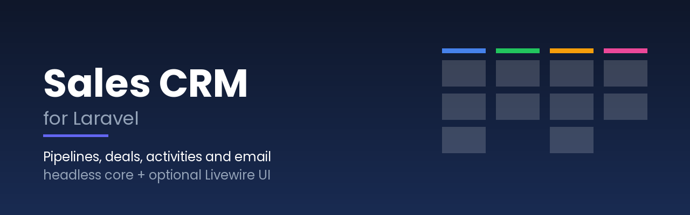

<p align="center">
  
</p>

# Sales CRM for Laravel

[](https://github.com/Sellinnate/laravel-sales-crm/actions/workflows/run-tests.yml)
[](phpstan.neon.dist)
[](composer.json)
[](composer.json)
[-fb70a9)](https://livewire.laravel.com)
[](LICENSE.md)
[](https://laravel-sales-crm.selli.io)

📖 **Full documentation: [laravel-sales-crm.selli.io](https://laravel-sales-crm.selli.io)**

Add a **sales CRM to any Laravel app**: pipelines and stages, deals, companies and
people, activities with reminders, notes, documents, emails that land on the deal
timeline, import/export and reports. The core is **headless** (actions, events,
policies and a fluent PHP API); a complete **Livewire UI** with a drag & drop
kanban board, optional **MCP tools** for AI agents and an optional **JSON API**
sit on top of it.

> **Your app stays in charge.** Your user model, your teams (or no teams at all),
> your gates, your mailer. The CRM plugs into them through a handful of small
> contracts with sensible defaults.

### What you can build

- 📋 **A sales pipeline for your team** at `/crm`, ready in minutes.
- 🔗 **Deals created by your app**: an order, a booking or a signup becomes a
  deal with `createDealFrom($model)`, idempotently.
- 🏢 **A CRM per tenant** in a multi-team SaaS (polymorphic workspaces).
- 🤖 **An AI assistant** that reads and updates deals through MCP tools.

## Table of contents

- [Features](#features)
- [Requirements](#requirements)
- [Installation](#installation)
- [Quick start](#quick-start)
- [The web UI](#the-web-ui)
- [Workspaces and permissions](#workspaces-and-permissions)
- [Email](#email)
- [Events](#events)
- [MCP tools and JSON API](#mcp-tools-and-json-api)
- [Documentation](#documentation)
- [Testing & development](#testing--development)
- [License](#license)

## Features

- **Pipelines and stages** — as many pipelines as you need; stages with colour,
  probability, rotting days, **required fields** (a deal can't enter "Proposal
  sent" without an amount) and an **activity created on entry**.
- **Deals** — one-off and recurring amounts, priority, source, tags, custom
  fields, next step, blocker, approval requests, won/lost with reasons, full
  history of stage changes.
- **Companies and people** — de-duplicated by VAT number, domain, email, phone
  or name (free-mail domains and shared sites are never used to match).
- **Activities** — calls, meetings, tasks and emails with due dates, reminders
  (`sales-crm:remind-activities`) and an agenda.
- **Notes with @mentions, documents** with versioned quotes and temporary signed
  links.
- **Email** — send from the deal through Laravel's mailer (threaded with
  `Message-ID`/`References`); receive replies through a **signed webhook**, an
  **IMAP** mailbox or your own driver; auto-replies and bounces are skipped.
- **Timeline** of deals, companies and people with correct counters per filter,
  extensible with your own entries (calls, tickets, orders…).
- **Import** from CSV or XLSX with column mapping suggestions, preview and a file
  of rejected rows; **export** to CSV/XLSX with formula neutralisation.
- **Reports** — open pipeline by stage (weighted), six-month forecast, won/lost
  and win rate, lost reasons, time spent in each stage, deals needing attention,
  activities, owners and sources.
- **Multi-tenancy** — optional polymorphic workspace on every record, resolved by
  a contract (built-in: single shared CRM or relation-based).
- **Authorization** — Laravel gates and policies behind an `Authorizer` contract;
  deals visible to the whole workspace or to their owner only.
- **22 events** (`DealCreated`, `DealStageChanged`, `DealWon`, `DealLost`,
  `ActivityDue`, `EmailReceived`…), dispatched after the database commit, and
  notifications on the channels you choose.
- **Optional Livewire 3/4 UI** with its own Blade components and precompiled
  Tailwind CSS — no build step in your app, English and Italian included.
- **Optional MCP server** (laravel/mcp) and **JSON API** (Sanctum by default).
- MySQL, PostgreSQL and SQLite; integer, UUID or ULID user keys; configurable
  table prefix (`crm_` by default).

## Requirements

| Requirement | Version |
|---|---|
| PHP | **8.2+** |
| Laravel | **11, 12 or 13** |
| Database | MySQL 8+, PostgreSQL or SQLite |
| Livewire | 3 or 4 (only for the UI) |

Optional packages, installed only if you need the feature:

| Package | Enables |
|---|---|
| `livewire/livewire` | the web UI |
| `openspout/openspout` | XLSX import and export (CSV works without it) |
| `laravel/mcp` | the MCP tools |
| `directorytree/imapengine` | the IMAP inbound driver |
| `giggsey/libphonenumber-for-php` | full phone number normalisation |

## Installation

```bash
composer require sellinnate/sales-crm

php artisan sales-crm:install          # publishes config + migrations, asks to migrate
php artisan sales-crm:install --demo   # optional: fictitious demo data (never in production)
```

> [!IMPORTANT]
> If your users (or teams) have **UUID or ULID keys**, set
> `database.user_key_type` / `database.workspace_key_type` in
> `config/sales-crm.php` **before** running the migrations. See
> [Installation](https://laravel-sales-crm.selli.io/getting-started/installation).

Schedule the reminders (and, with an inbound mailbox, the poller):

```php
// routes/console.php
use Illuminate\Support\Facades\Schedule;

Schedule::command('sales-crm:remind-activities')->everyMinute();
Schedule::command('sales-crm:poll-inbox')->everyFiveMinutes(); // only with the imap driver
```

## Quick start

```php
use Sellinnate\SalesCrm\Facades\SalesCrm;

$crm = SalesCrm::shared();               // or SalesCrm::for($team) with workspaces

// Create a deal: the company and the person are matched or created.
$deal = $crm->createDeal([
    'title' => 'Website redesign',
    'company_name' => 'Northwind Traders',
    'amount_once' => 12000,
    'person' => ['first_name' => 'Laura', 'email' => 'laura@northwind.example'],
], $user);

// Turn one of your models into a deal, once (idempotent).
$crm->createDealFrom($order, ['title' => 'Order #'.$order->id], $user);

// Move it: stages may require fields before the deal can enter them.
$proposal = $deal->pipeline->stages()->where('name', 'Proposal sent')->first();
SalesCrm::moveDeal($deal, $proposal, $user, fill: ['offer_valid_until' => '2026-12-31']);

// Plan the next step and write a note.
SalesCrm::scheduleActivity($deal, ['type' => 'call', 'title' => 'Follow up', 'due_date' => now()->addDays(2)->toDateString()], $user);
SalesCrm::addNote($deal, 'Budget confirmed by @Laura Bianchi', $user);

// Query it like any Eloquent model.
$crm->deals()->open()->with('stage')->get();
```

Then open **`/crm`** in the browser.

## The web UI

With `livewire/livewire` installed, the CRM is available at `/crm` (prefix,
domain, middleware and layout are configurable):

- **Board** — kanban with native drag & drop (no fixed column height), quick
  filters, saved views, list view with bulk actions and export.
- **Deal panel** — fields, people, activities, notes, emails, documents and the
  timeline with counters; required fields asked inline when moving a deal.
- **Agenda, companies, people, reports, import wizard and settings** (pipelines,
  stages, custom fields, email templates), plus an initial guide for new users.

The UI ships its own Blade components and precompiled CSS scoped to
`.sales-crm`, so it doesn't clash with your styles. Render it inside your own
layout by setting `sales-crm.ui.layout` and adding `<x-sales-crm::styles />` to
its `<head>`. Views and translations can be published
(`--tag=sales-crm-views`, `--tag=sales-crm-translations`).

## Workspaces and permissions

By default the whole app shares one CRM and every authenticated user can work
in it. Restrict it with two gates:

```php
Gate::define('sales-crm.access', fn (User $user) => $user->hasRole('sales'));
Gate::define('sales-crm.manage', fn (User $user, ?Team $team = null) => $user->is_admin); // $team: your workspace model, null without workspaces
```

To split the CRM by team, point the relation resolver at your models:

```php
// config/sales-crm.php
'workspaces' => [
    'resolver' => \Sellinnate\SalesCrm\Workspaces\RelationWorkspaceResolver::class,
    'model' => App\Models\Team::class,
    'user_relation' => 'teams',
    'members_relation' => 'users',
],
```

…or implement `Sellinnate\SalesCrm\Contracts\WorkspaceResolver` and
`Sellinnate\SalesCrm\Contracts\Authorizer` for anything else. See
[Workspaces](https://laravel-sales-crm.selli.io/concepts/workspaces) and
[Authorization](https://laravel-sales-crm.selli.io/concepts/authorization).

## Email

Emails written on a deal leave through Laravel's mailer; the sender is decided
by a `SenderResolver` (default: the user's name, your configured address,
replies to the user). To bring replies back to the deal timeline, choose an
inbound driver:

```dotenv
SALES_CRM_INBOUND_DRIVER=webhook     # null | webhook | imap
SALES_CRM_INBOUND_SECRET=a-long-random-string
```

The webhook accepts JSON signed with HMAC-SHA256 (`X-Sales-Crm-Signature`), the
IMAP driver polls a mailbox, and your code can push emails with
`SalesCrm::inbound()->receive(InboundEmail::fromArray([...]))`. See
[Email](https://laravel-sales-crm.selli.io/concepts/email).

## Events

Every change raises an event in `Sellinnate\SalesCrm\Events`, dispatched after
the transaction commits:

```php
Event::listen(function (DealWon $event) {
    Invoice::draftFor($event->deal, by: $event->by);
});
```

Full list: [Events reference](https://laravel-sales-crm.selli.io/reference/events).

## MCP tools and JSON API

```dotenv
SALES_CRM_MCP=true   # needs laravel/mcp: 9 tools at /mcp/crm
SALES_CRM_API=true   # JSON API at /api/crm (auth:sanctum by default)
```

Both go through the same actions, validation and authorization as the UI. See
[MCP tools](https://laravel-sales-crm.selli.io/interfaces/mcp) and
[JSON API](https://laravel-sales-crm.selli.io/interfaces/api).

## Documentation

The full documentation is hosted at
**[laravel-sales-crm.selli.io](https://laravel-sales-crm.selli.io)**. The
sources live in [`docs/`](docs/) and are built into a static site with
[docmd](https://docmd.io):

```bash
npm install
npm run docs:dev     # local preview
npm run docs:build   # static site into ./site
```

## Testing & development

```bash
composer install
composer test         # Pest suite (SQLite; set SALES_CRM_TEST_DB=mysql|pgsql for the others)
composer analyse      # PHPStan, level 8
composer format       # Laravel Pint
composer serve        # the workbench app with demo data: admin@example.test / password
npm run css:build     # rebuild resources/dist/sales-crm.css after changing the UI
```

See [CONTRIBUTING.md](CONTRIBUTING.md). Security issues: [SECURITY.md](SECURITY.md).

## License

MIT © Sellinnate S.r.l. — see [LICENSE.md](LICENSE.md).
